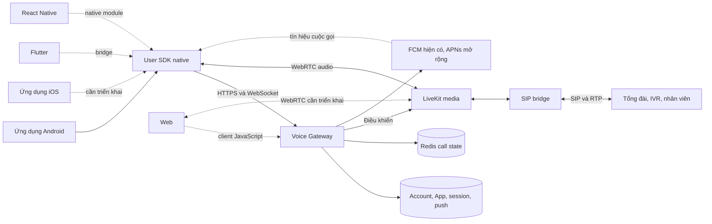
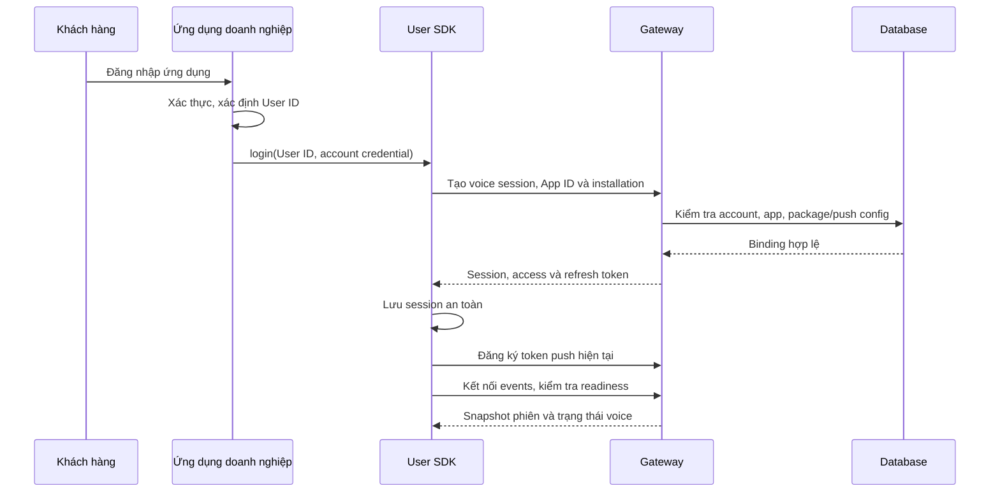
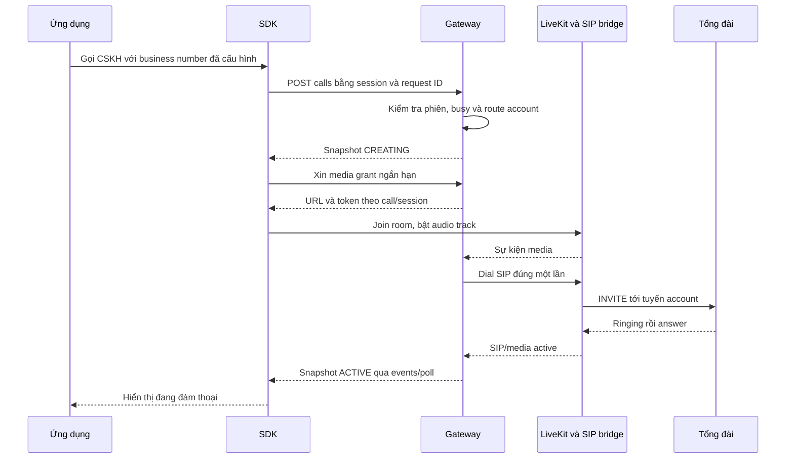
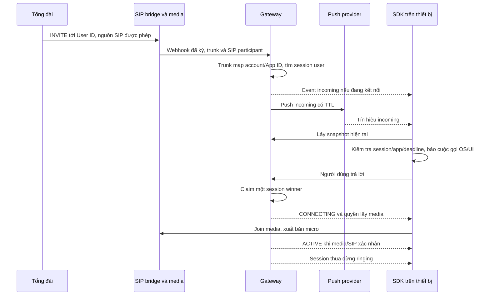
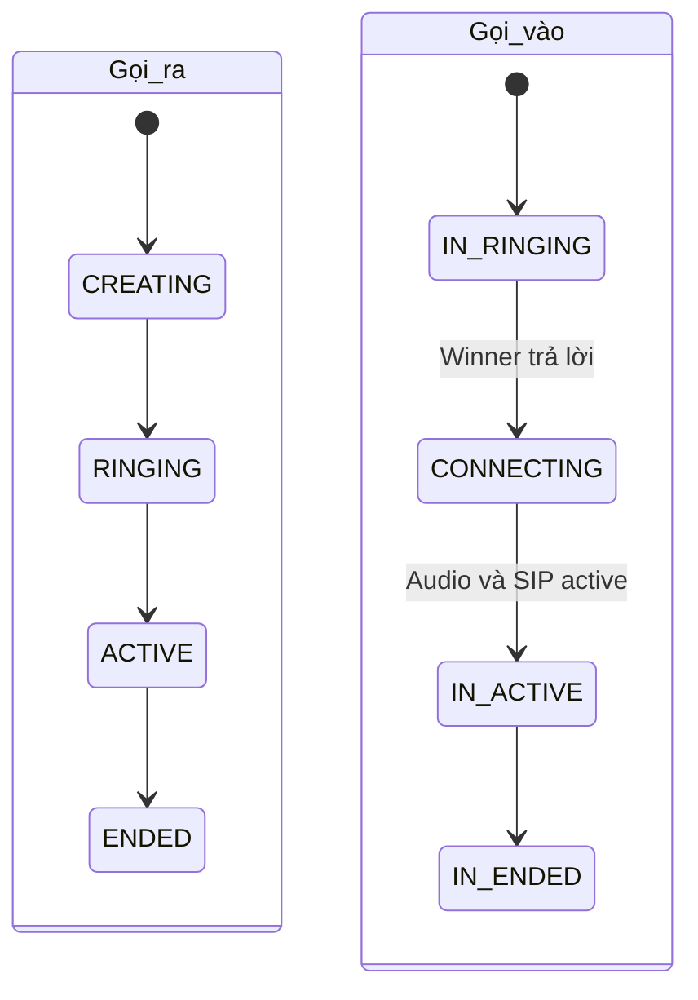

# Caresoft User Voice — Cách hệ thống hoạt động

Kiến trúc cho Android, iOS, Flutter, React Native và Web. Tài liệu dành cho đội sản phẩm, kỹ thuật tích hợp và vận hành tổng đài.

## 1. Mục đích và phạm vi

User Voice đưa cuộc gọi chăm sóc khách hàng vào ứng dụng của doanh nghiệp. Khách hàng đăng nhập bằng tài khoản của ứng dụng, bấm **Gọi CSKH** để gọi đầu số đã được cấp hoặc nhận cuộc gọi từ tổng đài tới User ID của mình. Khách hàng sử dụng Internet cho chặng ứng dụng; tổng đài tiếp tục dùng SIP cho chặng hạ tầng thoại.

Ứng dụng tự giữ đầu số do Caresoft cung cấp sau khi cấu hình định tuyến. SDK không tải danh bạ đầu số và không yêu cầu khách hàng nhập số trên bàn phím gọi ra. Bàn phím DTMF trong cuộc gọi phục vụ thao tác với IVR là chức năng khác. SDK khách hàng cũng không có trạng thái ca làm việc hay chọn thiết bị agent.

Kiến trúc tách gateway dùng chung khỏi client theo nền tảng. Một hệ thống backend có thể phục vụ nhiều loại client sau khi bổ sung adapter và hợp đồng platform phù hợp; binary Android không chạy trực tiếp trên iOS hoặc trình duyệt.

**Trạng thái triển khai của bộ User SDK này:** gateway 0.2.2, Android core 0.3.1, Android UI 0.3.2, demo Android 0.3.3. Android đã có implementation và kiểm thử. Các phần iOS, Flutter, React Native và Web bên dưới mô tả kiến trúc tích hợp/mở rộng, chưa phải tuyên bố đã có gói User SDK hoặc đã nghiệm thu trên các nền tảng đó. SDK agent có sẵn ở dự án khác dùng hợp đồng khác, không thay trực tiếp User SDK này.

## 2. Kiến trúc tổng thể

Gateway giữ danh tính/phiên và điều phối cuộc gọi; LiveKit xử lý media; SIP bridge nối với tổng đài. Push báo có thay đổi cuộc gọi khi client không giữ được kênh điều khiển liên tục.

### Các lớp và trách nhiệm

| Lớp | Trách nhiệm |
|---|---|
| Ứng dụng doanh nghiệp | Xác thực khách hàng, cung cấp User ID và cấu hình app, hiển thị nút Gọi CSKH, quản lý login/logout của host |
| User SDK | Phiên voice, điều khiển call, theo dõi state, media WebRTC, push forwarding, tích hợp âm thanh và UI theo nền tảng |
| Voice Gateway | Xác thực account/app/session, chọn tuyến, kiểm soát call ownership, phát media token ngắn hạn, gửi push và đồng bộ state |
| MySQL | Thông tin account/app/push, đăng ký thiết bị và session token hashes |
| Redis | Call state, busy scope, winner, idempotency và epoch coordinator |
| LiveKit và SIP bridge | Phòng media, kết nối WebRTC/SIP, chuyển media và sự kiện cuộc gọi |
| Tổng đài/Kamailio | Định tuyến đầu số, chính sách gọi, IVR/hàng đợi và phân phối tới nhân viên |
| FCM/APNs | Chuyển tín hiệu đánh thức/nhận cuộc gọi theo nền tảng; APNs cần adapter riêng trong User Gateway |

Có hai đường kết nối độc lập: **điều khiển** bằng HTTPS/WebSocket qua gateway và **âm thanh** qua WebRTC tới media server. Push là đường báo hiệu bổ sung, không mang âm thanh hoặc media credential.

## 3. Định danh và cấu hình

| Định danh | Ý nghĩa | Chủ thể cung cấp |
|---|---|---|
| Account ID | Doanh nghiệp/tenant sử dụng dịch vụ | Caresoft |
| Caresoft App ID | Ứng dụng được đăng ký trong account | Trang quản trị Caresoft |
| applicationId / Bundle ID | Định danh app do hệ điều hành/Firebase/APNs sử dụng | Đội phát triển app |
| User ID | Khách hàng cuối trong account, hiện là số nguyên không dấu 32 bit | Luồng xác thực của doanh nghiệp |
| Installation ID | Lần cài đặt app, khác phiên đăng nhập | SDK/client |
| Session ID | Phiên voice của user trên installation/app | Gateway |
| Business number | Đầu số CSKH mà app đã được cấp | Caresoft/tổng đài, app tự cấu hình |
| Call ID | Một cuộc gọi logic, dùng đối chiếu snapshot/actions | Gateway |

App ID Caresoft khác Firebase App ID, Android package và iOS Bundle ID. Đầu số không phải User ID. User ID dùng để định tuyến cuộc gọi vào khách hàng; đầu số dùng để chọn dịch vụ CSKH khi gọi ra.

Gateway lấy account credential và app/push config từ database hiện hành. App chỉ gửi định danh công khai, thông tin login và token push của thiết bị. App không được quyết định SIP peer, trunk, From domain, room hoặc push credentials.

### Cấu hình quản trị trước tích hợp

1. Tạo App trong **Admin Settings → Cơ bản → Voice SDK**, bật hoạt động và lấy App ID.
2. Tạo cấu hình push đúng nền tảng và applicationId/Bundle ID. Android hiện dùng FCM/default và service-account JSON phía server.
3. Caresoft cấu hình route account/app và tuyến tổng đài, cấp base URL/account/thông tin login cùng đầu số cho đội app.
4. Đội app cấu hình client đúng môi trường và nghiệm thu trên thiết bị/trình duyệt mục tiêu.

Các bước Android cụ thể ở [hướng dẫn tích hợp](android-integration-guide.md). iOS/APNs và Web Push chỉ áp dụng sau khi adapter User SDK/gateway tương ứng được phát triển.

## 4. Luồng đăng nhập và khôi phục phiên

Gateway hiện so sánh account API token với account trong DB. Token này xác thực tích hợp account; **host phải xác thực riêng khách hàng cuối và cung cấp đúng User ID**. Không coi việc biết User ID là đủ quyền đăng nhập. Không nhúng account token dài hạn trong source hoặc APK/JS bundle công khai. Trước production cần thống nhất cơ chế cấp credential với Caresoft; hợp đồng token ủy quyền theo từng user là phần cần thiết kế thêm nếu chọn thay account token trực tiếp hiện tại.

Gateway cấp access token riêng cho session, thời hạn hiện tại 15 phút, refresh lifetime tuyệt đối 24 giờ. DB lưu hash access/refresh. Android dùng Keystore lưu session, không lưu account token. Khi mở lại app, SDK khôi phục session rồi xác minh với server và đăng ký push lại. Hết phiên hoặc bị thu hồi yêu cầu host login lại; lỗi mạng đơn thuần tạo trạng thái chưa xác minh thay vì tự xóa phiên.

Đối với client khác, nơi lưu token và lifecycle phải theo nền tảng: iOS dùng kho bảo mật hệ điều hành, Flutter/React Native chuyển qua lớp native, Web cần mô hình lưu phiên và chống XSS/CSRF riêng. Không mặc định áp dụng cách lưu token Android cho trình duyệt.

## 5. Cuộc gọi ra từ khách hàng

App truyền đầu số nguyên bản. Gateway tra voice server của account và tạo SIP Request-URI/To dạng `SDKIN_<voice_server_id>_<business_number>` tới tổng đài. From vẫn là User ID dạng số. Đây là trách nhiệm gateway và tổng đài, không đưa prefix hoặc routing logic vào SDK.

Gateway chỉ dial sau khi client đã xuất bản audio track; HTTP tạo call thành công chưa đồng nghĩa đã kết nối. Request ID giúp nhận diện mutation trùng, nhưng app không được blind retry tạo cuộc gọi khi timeout. SDK đối chiếu snapshot/call hiện tại để tránh INVITE lặp.

Khi người dùng chọn loa/mute/DTMF, SDK điều khiển media và tích hợp audio route của nền tảng. UI chỉ đánh dấu route đã được hệ điều hành xác nhận. Các giới hạn tai nghe/Bluetooth và cơ chế focus phụ thuộc platform.

## 6. Cuộc gọi vào khách hàng

SIP Request-URI mang User ID khách hàng. Inbound trunk chuyên biệt quyết định account/App ID đích; From của tổng đài mang đầu số dịch vụ. Gateway không chọn app dựa trên tập thiết bị đang online và không cần registry đầu số trong SDK.

Gateway gửi cho các session đủ điều kiện của đúng account/app/user. Nếu một user có nhiều thiết bị, claim answer atomic chỉ cho một session thắng; các thiết bị còn lại dừng ringing và không có quyền media/hangup của winner.

Push có thể tới muộn, lặp hoặc sau khi caller đã hủy. SDK coi payload là tín hiệu, lấy snapshot và kiểm tra hạn trước khi hiển thị/answer. Push không chứa access/refresh/media token. Trên Android hiện có FCM data high priority và notification cuộc gọi; cơ chế PushKit/CallKit trên iOS cần implementation riêng, bao gồm yêu cầu report cuộc gọi của hệ điều hành.

## 7. Trạng thái, readiness và kết thúc

Các trạng thái trung gian cũng có thể kết thúc vì hủy, từ chối, hết hạn hoặc lỗi. Client tuân snapshot version tăng, không dùng event cũ để hồi sinh call đã terminal. Gateway quản lý media deadline 10 giây, ringing 45 giây và guard call tối đa 30 phút ở cấu hình hiện tại. Trạng thái và timeout có thể được phát hiện qua vòng đối soát định kỳ.

| Tín hiệu readiness Android | Ý nghĩa |
|---|---|
| `isLoggedIn` | Session hiện tại đã được server xác minh gần đây |
| `canCall` | Session hợp lệ, voice sẵn sàng, có micro, không bận |
| `canReceive` | Thêm push registration và quyền notification |
| `UNKNOWN` | Chưa xác minh được, thường do mạng; không đồng nghĩa logout |
| `controlConnected` | Kênh events đang kết nối, độc lập với credential hợp lệ |

Host gọi `checkReadiness()` và quan sát flow để điều chỉnh nút và hướng dẫn người dùng. Readiness là điều kiện tại thời điểm quan sát, không bảo đảm nhận push, bật full-screen hoặc RTP xuyên mọi mạng. Với nền tảng khác, giữ ý nghĩa tương đương nhưng đánh giá quyền theo OS/browser.

Khi một bên gác máy, gateway chuyển terminal, dọn room/busy và phát event/push kết thúc. SDK dừng audio/notification/cuộc gọi hệ điều hành. Activity cuộc gọi Android đi kèm tự đóng và trở về màn hình trước. Host nhúng view riêng phải tự điều hướng. Logout kết thúc call và xóa local session; nếu server revoke không được xác nhận, host cần hiển thị đúng kết quả.

## 8. Phân chia theo nền tảng

| Nền tảng | Cách tích hợp dự kiến | Tích hợp hệ điều hành | Trạng thái User SDK |
|---|---|---|---|
| Android | Kotlin/Java dùng AAR/Maven core và UI tùy chọn | Telecom, FCM, foreground service, notification/full-screen, audio focus | Đã có source, demo và kiểm thử |
| iOS | SDK native Swift/Objective-C riêng | CallKit, PushKit/APNs VoIP, AVAudioSession, Keychain | Cần phát triển client, push adapter và kiểm thử |
| Flutter | Plugin Dart gọi native User SDK trên từng OS | Giữ luồng native nhận push/cuộc gọi khi Dart chưa chạy | Chưa có plugin User SDK trong bộ này |
| React Native | JS/TS API qua native module, events nhất quán | Giữ native lifecycle, không chờ JS để xử lý callback OS | Chưa có module User SDK trong bộ này |
| Web | SDK JavaScript/TypeScript dùng HTTPS/WebSocket và WebRTC | Quyền micro, autoplay, tab lifecycle, thiết bị âm thanh | Cần client và hợp đồng platform/browser riêng |

Flutter/React Native tái sử dụng Android core cho phần Android thông qua bridge. Phần iOS vẫn cần SDK native iOS User Voice; wrapper không tự cung cấp CallKit/PushKit. API nghiệp vụ có thể thống nhất tên và model, nhưng kiểu dữ liệu, async/event binding và UI adapter khác nhau.

Trình duyệt không có Telecom/CallKit như app native, không bảo đảm background/full-screen khi đóng tab hoặc browser. Web Push/service worker cần hợp đồng server và thử nghiệm riêng, không mặc định coi là đã có. Gateway hiện login/push registration giới hạn Android và sender FCM; thêm nền tảng phải mở rộng validation/config/provider có chủ đích, không chỉ đổi chuỗi `os` ở client.

## 9. Bảo mật và cô lập

| Ranh giới | Cơ chế và trách nhiệm |
|---|---|
| App tới gateway | HTTPS, account/app/package/session binding, không đưa credential vào URL/log |
| Session | Token ngẫu nhiên, access/refresh có hạn, DB lưu hash, thu hồi theo installation/session |
| Call/media | Grant ngắn hạn theo room/identity/winner, snapshot authoritative, epoch chặn tác vụ cũ |
| Account/App | Scope kiểm tra ở API, state và push; không cho client chọn trunk/peer |
| SIP/RTP | Inbound allowlist và firewall source riêng cho signaling/media, webhook LiveKit đã ký |
| Push server | Credentials ở cấu hình quản trị/DB, không đóng gói trong app; kiểm tra binding lại trước gửi |

API token account vẫn là credential có phạm vi rộng. Thiết kế phát hành phải giải quyết cách cấp credential an toàn và xác thực user trước khi cho phép sử dụng; không suy rằng TLS hoặc lưu Keystore làm token nhúng sẵn trong binary trở thành bí mật.

Không có tính năng ghi âm, chuyển cuộc gọi, video, lịch sử phân tích, SLA hay cơ chế scale ngang tự động được cam kết trong tài liệu này. Các tính năng đó cần phạm vi và nghiệm thu riêng.

## 10. Triển khai và vận hành

Gateway gồm API Java, MySQL Caresoft, Redis riêng, LiveKit/SIP và TLS proxy. Tách room prefix, keys, Redis state và trunk/dispatch khỏi hệ thống khác. Một coordinator quản lý một scope state ở implementation hiện tại; không chạy nhiều API instance chung scope như một backend stateless.

Startup xác thực cấu hình/phụ thuộc rồi đối soát và dọn room thuộc prefix sở hữu. Restart kết thúc call cũ, không hồi sinh hoặc dial lại cuộc gọi chưa rõ kết quả. Operator lên lịch restart phù hợp và kiểm tra readiness trước mở tuyến.

Theo dõi liveness/readiness nội bộ, lỗi dependency, tỷ lệ call kết nối/kết thúc, push rejection và thời gian xử lý bằng công cụ vận hành của môi trường. Các chỉ số cần được đo thực tế; bộ bàn giao không đưa ra con số tải hoặc độ trễ chưa kiểm chứng. Không public health/admin endpoints và không log token/SIP capture chứa dữ liệu khách hàng.

Nghiệm thu gồm gọi ra/vào đúng user/account/app, audio hai chiều, mute/speaker/DTMF, foreground/background/locked screen, multi-device, mất mạng, logout/rotation, source filtering và cleanup sau restart. Android Force stop và Web đóng tab có giới hạn hệ điều hành cần thông báo cho người dùng.

## 11. Lộ trình triển khai một nền tảng mới

1. Thống nhất model account/app/user/session/call và credential contract an toàn cho nền tảng đó.
2. Bổ sung gateway validation/binding cho platform, push provider và đăng ký thiết bị tương ứng.
3. Xây client native hoặc browser, lưu phiên, media WebRTC và đồng bộ snapshot.
4. Tích hợp cuộc gọi, push, permission, audio và UI theo lifecycle OS/browser.
5. Với Flutter/React Native, thêm bridge và thống nhất events/errors, kiểm tra khi runtime chưa sẵn sàng.
6. Nghiệm thu mạng/thiết bị thực tế rồi mới công bố package, hướng dẫn và phiên bản hỗ trợ.

Không cần nhân bản toàn bộ gateway cho mỗi nền tảng. Có thể dùng chung nghiệp vụ và hạ tầng, đồng thời triển khai các adapter platform còn thiếu.

## 12. Tài liệu và bộ bàn giao

- [Tích hợp Android từng bước](android-integration-guide.md)
- [API SDK Android](sdk-api.md)
- [Demo](../demo/README.md) và [checklist nghiệm thu](testing.md)
- [Source gateway và tài liệu vận hành](https://github.com/caresoftgit/sdk_voice_gateway)
- [Source SDK Android](https://github.com/caresoftgit/user_voice_sdk_android)
- [Bộ tài liệu và thuyết trình](../presentation/README.md)

Sơ đồ dùng định danh vai trò và placeholder; không chứa cấu hình, đầu số, account hoặc token của môi trường vận hành.
